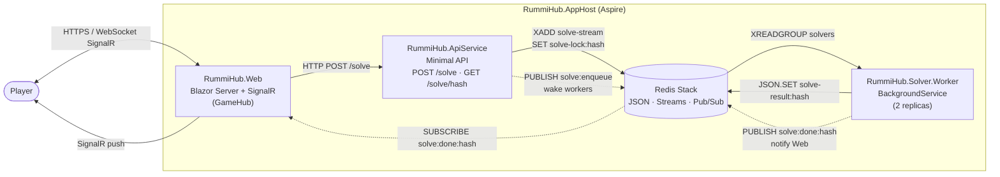

# RummiHub Architecture

Application orchestrated by **.NET Aspire** (`RummiHub.AppHost/AppHost.cs`).

## Overview

Solid arrows = durable data path (queue + cache). Dashed arrows = ephemeral Pub/Sub notifications.

## Components

| Project | Role |
|---|---|
| `RummiHub.AppHost` | Aspire orchestrator: declares Redis, the API, the worker (×2) and the web front. |
| `RummiHub.Web` | Blazor Server, `GameHub` SignalR hub, `GameManager`, `SolveResultSubscriber`. |
| `RummiHub.ApiService` | Receives solve requests, deduplicates by content hash, enqueues into Redis. |
| `RummiHub.Solver.Worker` | Consumes the Redis stream, runs the strategy (`GraphStrategy`), publishes the result. |
| `RummiHub.Core` | Shared models (`Tile`, `Set`, `Solution`) and contracts (`SolveRequest/Response`, `ContentHasher`). |
| `RummiHub.ServiceDefaults` | OpenTelemetry, health checks, service discovery. |
| Redis Stack | Cache (`solve-result:hash`), lock (`solve-lock:hash`), stream (`solve-stream`), pub/sub channels. |

## Stream vs Pub/Sub: why both?

They serve **different purposes** and complement each other.

### Redis Stream — `solve-stream` (the work queue)

- **Durable, persistent log** of solve jobs. Survives restarts.
- **Consumer group `solvers`** distributes each message to exactly one worker (load balancing across the 2 replicas).
- **`XACK` + pending list**: if a worker crashes mid-solve, the message stays pending and is recovered on restart (`ProcessPendingMessages` in `SolverWorker.cs`).
- **Capped length** (`maxLength: 1000`) to bound memory.

→ Used for **work that must not be lost**.

### Redis Pub/Sub — two channels (lightweight notifications)

Pub/Sub is **fire-and-forget**: no persistence, no replay, delivered only to currently connected subscribers. That's exactly what we want for transient signals.

| Channel | Publisher → Subscriber | Purpose |
|---|---|---|
| `solve:enqueue` | API → Workers | "A new job is in the stream, wake up." Avoids workers polling `XREADGROUP` in a tight loop — they block on a `Channel<bool>` and are signaled instantly. |
| `solve:done:hash` | Worker → Web | "Result for `hash` is ready in the cache." The Web tier reads `solve-result:hash` from Redis JSON and pushes it to the right Blazor session via SignalR. |

→ Used for **wake-ups and result-ready signals**, where missing a message is acceptable (the result is already safely in the stream/cache, and a polling fallback could always recover it).

### Why not just one or the other?

- **Stream only**: workers would have to poll, and Web would have no way to know when a result is ready without polling `GET /solve/hash`.
- **Pub/Sub only**: a worker crash or a disconnected subscriber would silently drop the job — no retry, no durability.

The pattern is the standard Redis split: **Streams carry the workload, Pub/Sub carries the notifications.**

## Solve flow

1. The player triggers a solve from the Blazor front.
2. `Web` calls `POST /solve` on `ApiService`.
3. `ApiService` computes the `contentHash`, checks the Redis JSON cache; if miss, acquires a `SET NX` lock (10 min TTL), `XADD`s into `solve-stream`, then `PUBLISH`es on `solve:enqueue`.
4. A `SolverWorker` reads the stream via the `solvers` consumer group, runs `GraphStrategy`, writes `solve-result:hash` (1 h TTL), `PUBLISH`es on `solve:done:hash`, `XACK`s the message, and releases the lock.
5. `SolveResultSubscriber` (Web) receives the notification, fetches the result from the cache, and pushes it to the right client via SignalR.
