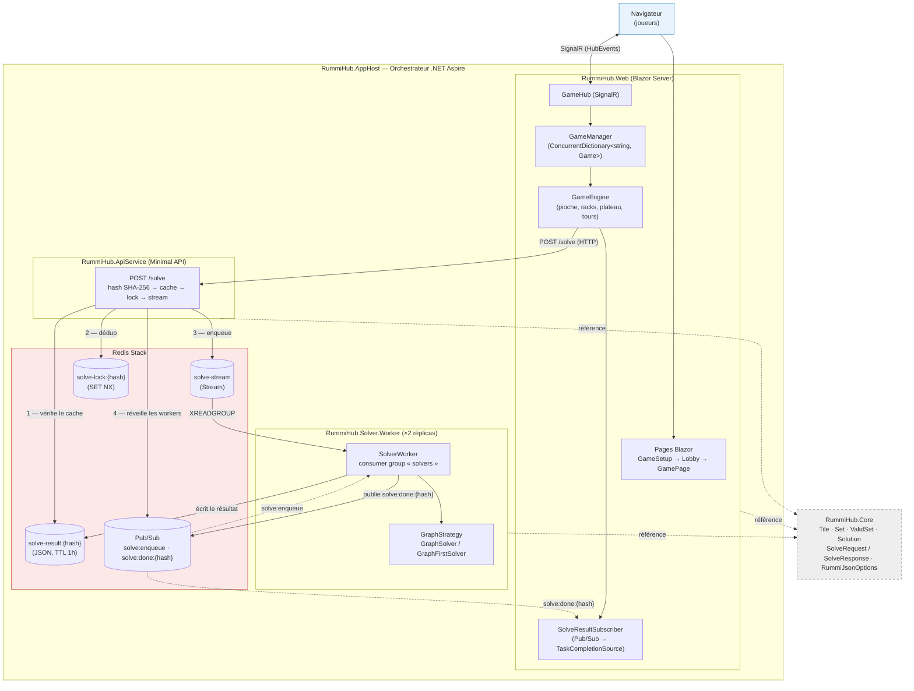
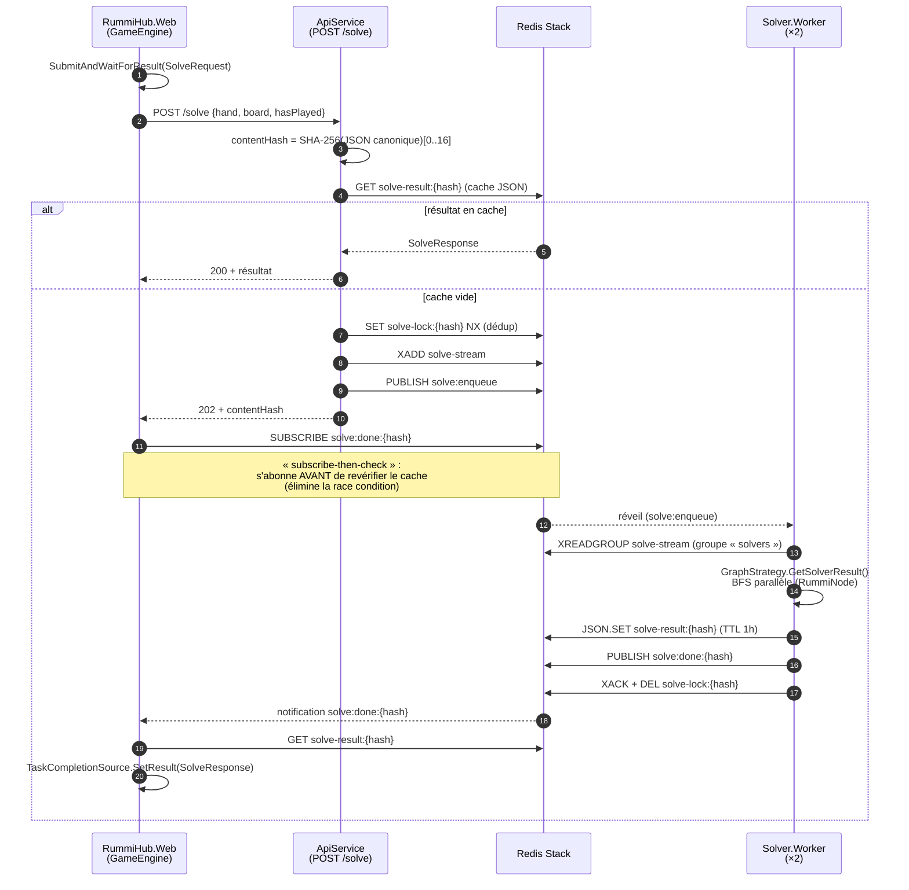

# Architecture RummiHub

RummiHub est orchestré par **.NET Aspire** (`RummiHub.AppHost`), qui démarre et relie quatre ressources : le frontend Blazor Server, l'API minimale, les workers de résolution (×2 réplicas) et Redis Stack. `RummiHub.Core` est la bibliothèque partagée (modèle de domaine et contrats) référencée par les trois services.

## Topologie des services

## Pipeline de résolution (chemin critique)

Le solveur est entièrement asynchrone et distribué. L'API répond **202** avec le `contentHash` ; le Web s'abonne au canal `solve:done:{hash}` **avant** de revérifier le cache (« subscribe-then-check ») pour éliminer toute race condition avec les workers.

## Points clés

- **Dédup des solves** : un même état de jeu (même `contentHash`) n'est calculé qu'une fois, quel que soit le nombre de demandeurs — verrou `solve-lock:{hash}` (SET NX) + cache `solve-result:{hash}`.
- **Résilience des workers** : consumer group Redis Streams ; au démarrage, un worker récupère les messages pending (non-ACKés) d'un worker tombé.
- **Concurrence côté jeu** : toutes les mutations d'une partie passent par `Game.ActionLock` (`SemaphoreSlim(1,1)`), via le `GameHub` SignalR.
- **Sérialisation** : `RummiJsonOptions.Default` est l'unique `JsonSerializerOptions` partagé entre API, workers et Web (camelCase, enums en string, `TileJsonConverter`).
